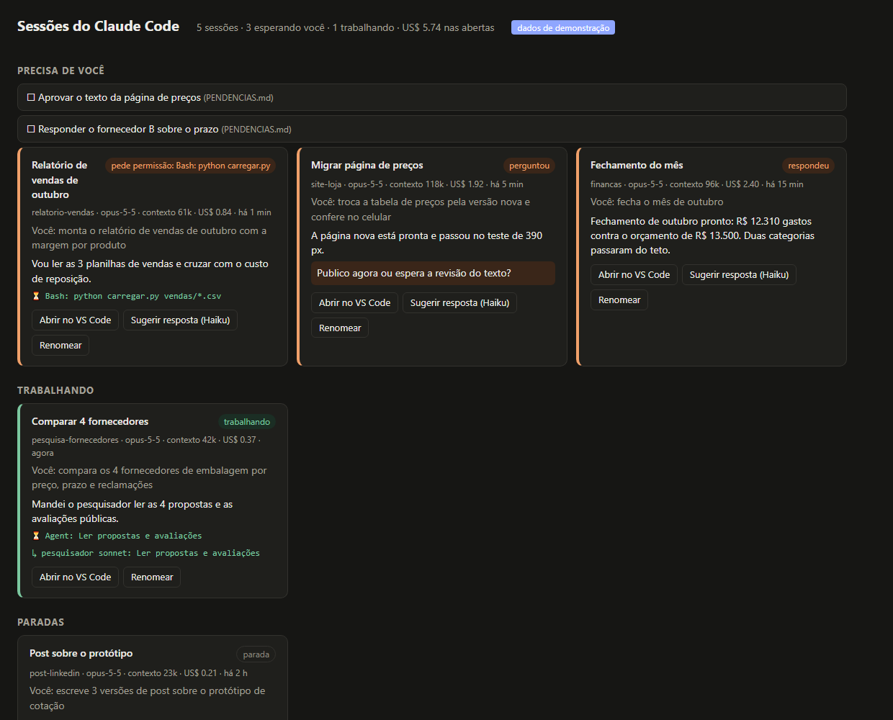

# claude-code-ops

*English below · [Português mais abaixo](#português)*

A small operations kit for people who run **several Claude Code sessions at once**: a local monitor that shows which sessions need you, a hand-off file between sessions, a usage meter that switches to economy mode near the weekly limit, and hooks that keep agents on the right browser profile and surface reminders and bills at session start.

Built and used daily on Windows, across about 17 project folders and roughly 1,800 sessions in seven weeks (Oct–Nov 2026).



## What's inside
| Piece | What it does | Files |
|---|---|---|
| **Session monitor** | Local page (127.0.0.1) that groups every open session by what it needs from you. The states are: asking permission, asked a question, interrupted, answered, working, idle. Each card shows the last request, the start of the reply, the pending tool, running subagents, context size, cost and model. One click opens the session in VS Code, renames its tab, or asks Haiku for 3 reply suggestions (~US$ 0.004). Reads local files only; no API calls unless you click "suggest". | `monitor/` |
| **Hand-off ("bastão")** | A fixed-format `PROXIMA-SESSAO.md` per folder (open fronts with "Next:", what failed, next steps), with a timestamp and a size cap. A SessionStart hook announces it in one line, so a fresh session knows where the last one stopped. | `hooks/bastao.py`, `skills/bastao/` |
| **Learn from feedback** | Skill that turns every correction into a permanent rule. The steps: log it verbatim, adjust the rule, and add an **automated check when the defect is measurable**. Each check is tested against the failing case and an approved one. Rules on paper did not stop repeats; checks did. | `skills/aprender-com-feedback/` |
| **Usage meter** | Status line with the weekly and 5-hour usage. Above 80% it injects "economy mode" into the session; above 90% "reserve mode", and it blocks new subagents. It uses only the `rate_limits` field the status line already receives: no token, no extra API call. | `hooks/uso_claude.py` |
| **Cost-aware delegation** | Generic `operador` (Haiku, mechanical work) and `pesquisador` (Sonnet, read a lot, return only the conclusion with sources) agents, plus the table of which model does what. | `agents/`, `docs/modelos-por-custo.md` |
| **Guardrail hooks** | Block the wrong browser profile per folder. Show reminders that fall inside a date window. Warn about bills due today, tomorrow or overdue. Play a sound when a reply finishes. | `hooks/*.ps1` |

## Try the monitor in 1 minute
```bash
pip install psutil                 # optional: confirms each session process is alive
python monitor/gerar_demo.py       # creates fake sessions in monitor/demo/
python monitor/monitor.py --demo   # open http://127.0.0.1:8771
python monitor/monitor.py          # your real sessions (reads ~/.claude)
```

## Install the hooks
1. Copy `hooks/` to `~/.claude/hooks/`, `skills/` to `~/.claude/skills/` and `agents/` to `~/.claude/agents/`.
2. Merge `exemplos/settings.example.json` into `~/.claude/settings.json`. Check the paths: the examples use `~`.
3. Optional data files: copy them from `exemplos/` to `~/.claude/` without the `.example` part:
   - `lembretes.md`;
   - `contas-recorrentes.md`;
   - `navegadores.json`.

The PowerShell hooks are Windows-only; the Python ones run anywhere.

## Design notes
- **Read-only by default.** The monitor writes only when you click. The rename appends one `custom-title` line to the transcript, the same thing `/rename` does.
- **Local-only page.** It binds to 127.0.0.1, rejects foreign `Host` headers (DNS rebinding), and every action needs a per-run token.
- **The cheapest call that works.** The Haiku suggestion runs `claude -p` with no tools, hooks or MCP, and with a one-line system prompt (measured ~13x cheaper than the default prompt).
- Code and comments are in Portuguese; that is how it was built and used.

Built by João Victor Medawar Machado with Claude Code as pair programmer. MIT license.

---

## Português

Kit de operação para quem toca **várias sessões do Claude Code ao mesmo tempo**.

- **Monitor de sessões:** mostra quais sessões esperam você.
- **Bastão:** passa o estado de uma sessão para a próxima.
- **Aprender com feedback:** transforma correção em regra e checagem automática.
- **Medidor de uso:** entra em modo economia perto do limite semanal.
- **Agentes por custo:** Haiku para o braçal, Sonnet para pesquisa.
- **Hooks de segurança:** perfil de navegador certo por pasta, lembretes por janela de datas, contas do dia e aviso sonoro no fim da resposta.

Feito e usado no dia a dia no Windows, em cerca de 17 pastas de projeto e umas 1.800 sessões em sete semanas (out–nov/2026). Para testar o monitor e instalar os hooks, veja as seções em inglês acima; os comandos são os mesmos.
